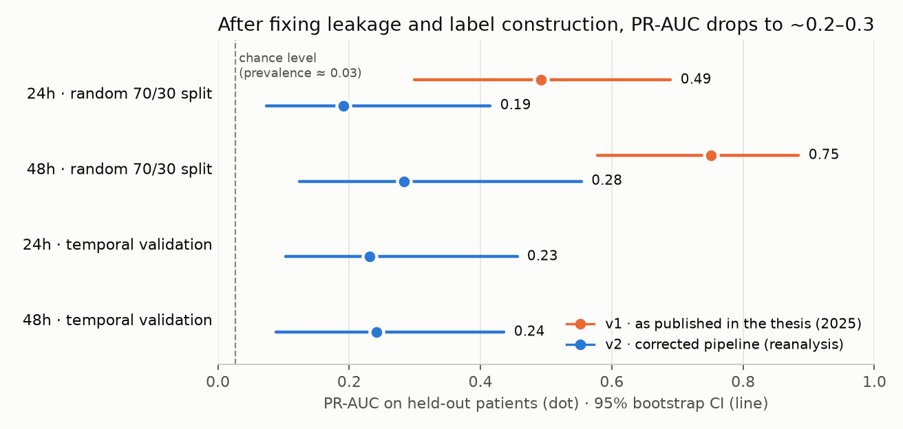
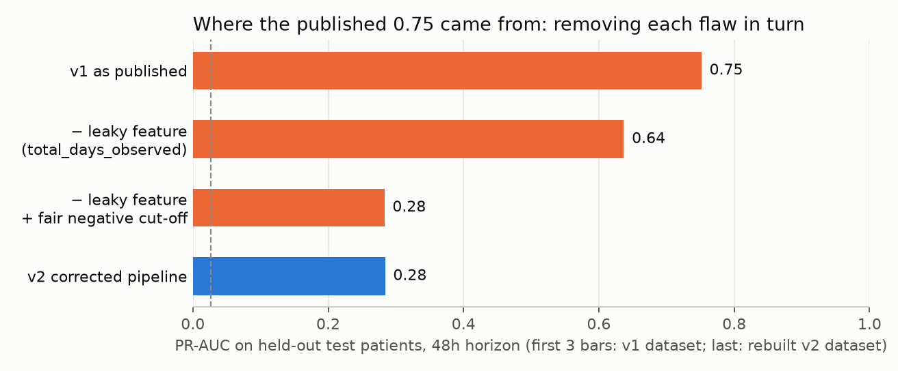
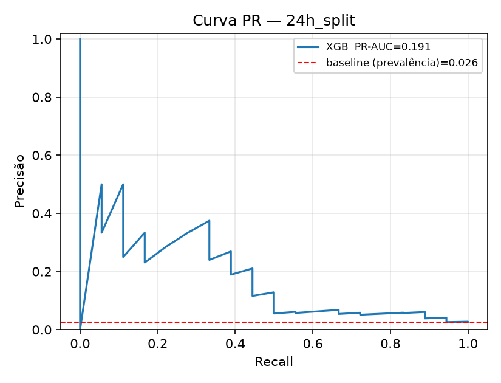
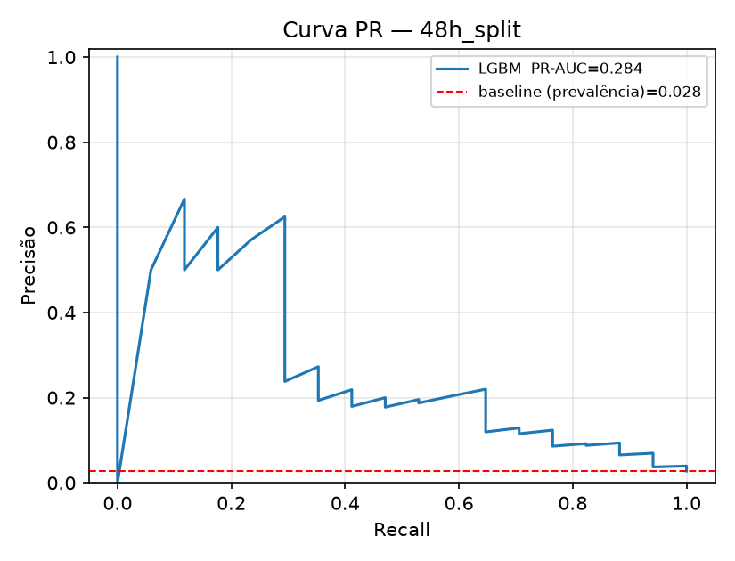
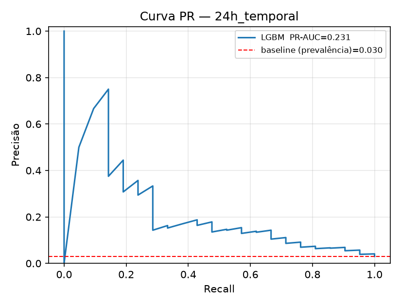
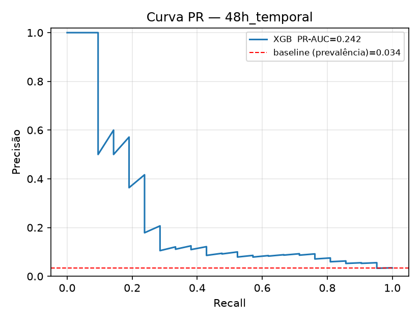
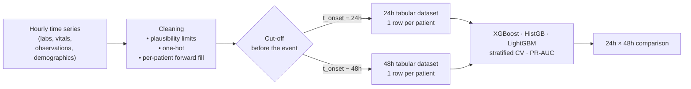
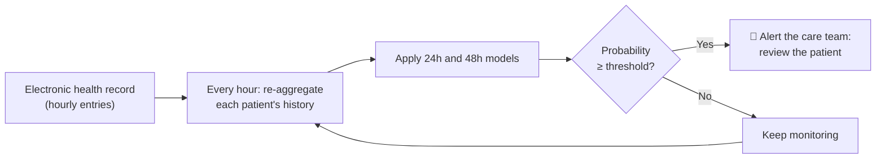

# Early Sepsis Prediction in Pediatric ICUs: MBA Thesis + Critical Reanalysis

[🇧🇷 Português](README.md) | **🇺🇸 English**

Capstone thesis, **MBA in Data Science (CEMEAI / ICMC – University of São Paulo, São Carlos), 2025**
Author: **Juscelino Alves de Carvalho** · Advisor: **Prof. Francisco Louzada**


> [!IMPORTANT]
> **Read this first.** This repository has **two layers**:
>
> 1. **The original thesis (v1, 2025).** I built it while I was still learning data science. It is published
>    **as submitted**, to show where I started. The only change is the corrected operating-point numbers on
>    p. 32 (flaw #4 below).
> 2. **A critical reanalysis (v2).** After gaining more experience, I went back to the project and **found
>    methodological flaws that inflated the results**: future information leaking into the features (*data
>    leakage*) and an asymmetric label design between classes. I measured the effect of each flaw, rebuilt the
>    pipeline and re-evaluated everything with stricter validation.
>
> **Honest outcome:** the published PR-AUC of **0.75** drops to **about 0.2–0.3** once the flaws are fixed.
> There is a real predictive signal (7–10× above chance), but it is **not good enough for clinical use**.
> Nothing is hidden: the errors, the discrepancies and the fixes are all documented below.

---

## ⚡ 30-second summary

| | **v1: as published in the thesis** | **v2: corrected pipeline** |
|---|---|---|
| PR-AUC 48h (test) | 0.75 | **0.28** (95% CI: 0.12–0.55) |
| PR-AUC 24h (test) | 0.49 | **0.19** (95% CI: 0.07–0.42) |
| Temporal validation (train on older years, test on recent ones) | not done | **0.23–0.24** |
| "48h beats 24h" | yes | **does not hold** (overlapping CIs) |
| Recall at the operating point | 84% (with leakage) | **about 30%**, with about 3 alerts per true case |
| Ready for clinical use? | implied | **no** |

*Chance level: PR-AUC equals the prevalence, about 0.03.*



---

## 🧠 What this project demonstrates

| Skill | Where it shows |
|---|---|
| **Clinical time-series processing** (hourly, sparse, >90% missing in many variables) | Per-patient aggregation up to a cut-off, plausibility limits, per-patient forward fill, trend and "hours since last measurement" features |
| **Highly imbalanced data** (about 3% positives) | PR-AUC instead of accuracy, class weights (`scale_pos_weight` / `class_weight`), prevalence as baseline |
| **Threshold selection** | Clinical rule (highest recall with precision ≥ 25%), chosen on out-of-fold training predictions and **never on the test set** |
| **Rigorous evaluation and comparison** | 95% bootstrap CIs, repeated stratified 5×5 CV, **temporal validation**, 24h × 48h comparison with uncertainty |
| **Data-leakage detection** | Found a feature that looked into the future and a bias in how classes were built, then ran ablation experiments to measure each effect |
| **Critical thinking and honest reporting** | Reviewing my own work, publishing the numbers that got worse, and explaining why |

---

## 🔍 Retrospective: what was wrong in v1



| # | Flaw in v1 | Why it inflated the result | Measured effect (48h PR-AUC) | Fix in v2 |
|---|---|---|---|---|
| 1 | **Leaky `total_days_observed`.** Computed from the patient's **last timestamp in the whole record**, including after sepsis | The model "knew" how long the patient would still stay in the ICU, which is unknown at prediction time. It was the **#1 feature** of the 48h model | 0.75 → 0.64 | Removed. Replaced by `hours_since_admission`, computed **only up to the cut-off** |
| 2 | **Asymmetric cut-off.** Negatives summarized **up to discharge**, positives **before sepsis** | The model learned "early stay vs. end of stay" rather than "will develop sepsis vs. will not" | 0.64 → 0.28 | Negative cut-offs sampled to match the positives' **hours-since-admission distribution** |
| 3 | **Synthetic D-1/D-2 rows.** 17 (24h) and 26 (48h) of the 82 positives had **no clinical data at all** before the cut-off | "Empty" positives with a distinctive missingness pattern that is easy to recognize | not isolated | No synthetic rows. **Same inclusion rule** for both classes: ≥ 6h of stay and at least one real measurement |
| 4 | **Notebook bug (cell 70).** Recall and precision printed with an index left over from the 24h curve | The submitted Portuguese thesis (p. 32) reported *Recall 0.72 / Precision 0.69*, inconsistent with the confusion matrix | — | Fixed in notebook 01 (old lines kept as comments) and in the thesis PDF published here. Correct values: recall 0.84 and precision 0.25 |
| 5 | **Fragile evaluation.** A single split, 25 positives in the test set and no confidence interval | With so few positives, one number looks more precise than it is (real CI: 0.58–0.88) | — | Bootstrap, repeated 5×5 CV and temporal validation |

> **How I found it:** the top feature being "total observation time" was the first red flag. An
> administrative variable beating every clinical marker usually signals leakage. That led to the ablation
> experiments in [`reanalysis/01_diagnose_v1.py`](reanalysis/01_diagnose_v1.py), which change **one factor at
> a time** on top of the original pipeline.

---

## ✅ Corrected version (v2)

**Code:** [`reanalysis/02_corrected_pipeline_v2.py`](reanalysis/02_corrected_pipeline_v2.py) ·
**Raw results:** [`reanalysis/results/results_v2.json`](reanalysis/results/results_v2.json)

| | 24h | 48h |
|---|---|---|
| Patients / with sepsis | 2,332 / 61 | 2,039 / 56 |
| Sepsis cases excluded (too early, no data before the cut-off) | 36 of 97 | 41 of 97 |
| **70/30 split:** PR-AUC (95% CI) · ROC-AUC | 0.19 (0.07–0.42) · 0.79 | 0.28 (0.12–0.55) · 0.87 |
| **Repeated 5×5 CV:** PR-AUC mean ± sd | 0.24 ± 0.08 | 0.18 ± 0.10 |
| **Temporal validation:** PR-AUC (95% CI) · ROC-AUC | 0.23 (0.10–0.46) · 0.84 | 0.24 (0.09–0.44) · 0.77 |
| **Operating point** (OOF threshold): recall / precision / specificity | 0.33 / 0.35 / 0.98 | 0.29 / 0.36 / 0.98 |
| Confusion matrix (TN / FP / FN / TP) | 671 / 11 / 12 / 6 | 586 / 9 / 12 / 5 |

**Most important features:** temperature, CRP, procalcitonin, lactate, hematocrit and hours since admission.
The **number of tests ordered** (neutrophils, hematocrit, blood gases) also carries weight.

<details>
<summary>v2 precision–recall curves (click to expand)</summary>

| 24h, split | 48h, split |
|---|---|
|  |  |
| **24h, temporal** | **48h, temporal** |
|  |  |

</details>

---

## 🏥 Why it is not usable in practice, but still worth studying

**Why it is not clinically usable:**
- The model catches **about 1 in 3 sepsis cases**, with about 3 alerts per true case. Raising recall makes
  precision drop quickly.
- Part of the signal is **the care team's own suspicion**: the number of tests ordered weighs on the model.
  It partly captures what clinicians already noticed, which limits the real gain.
- **About 40% of sepsis cases happen too early** (a few hours after admission) for any 24h or 48h-ahead
  prediction.
- Few positives (17–21 per test set, hence the wide CIs), a single hospital and one cut-off per patient.
  Real use would require scoring every hour.

**Why it is still a good study:**
- The signal is **real and stable**, 7–10× above chance, and it **does not degrade** under temporal
  validation.
- The approach (hourly series → tabular dataset per prediction horizon → gradient boosting with
  imbalance-aware metrics) is sound and documented end to end.
- The v1 × v2 comparison is a **concrete case of how data leakage inflates metrics**, and of how to detect
  and measure it.

**Next steps, if this were heading to production:** hourly scoring for every admitted patient, data from more
hospitals and years, and a comparison against simple clinical scores (qSOFA, Phoenix pediatric criteria) to
measure the model's real added value.

---

## 📚 Where to start

| I want to... | Open |
|---|---|
| **See the reanalysis and the corrected code** | [`reanalysis/`](reanalysis/) |
| Read the full thesis in English (translation, with a correction note in section 4.2) | [`docs/TCC_Sepsis_Pediatric_ICU_EN.pdf`](docs/TCC_Sepsis_Pediatric_ICU_EN.pdf) |
| Read the original thesis (Portuguese, v1) | [`docs/TCC_Sepse_UTI_Pediatrica_PT-BR.pdf`](docs/TCC_Sepse_UTI_Pediatrica_PT-BR.pdf) |
| Browse the defense slides (Portuguese) | [`apresentacao/Apresentacao_TCC_Sepse_PT-BR.pptx`](apresentacao/Apresentacao_TCC_Sepse_PT-BR.pptx) |
| See the original thesis notebook (v1, Portuguese) | [`notebooks/01_pipeline_agregacao_24h_48h_PT-BR.ipynb`](notebooks/01_pipeline_agregacao_24h_48h_PT-BR.ipynb) |
| See the hourly variant (hackathon submission) | [`notebooks/02_modelo_horario_hackathon_PT-BR.ipynb`](notebooks/02_modelo_horario_hackathon_PT-BR.ipynb) |

---

## 📜 The original thesis (v1), as submitted

<details>
<summary><b>Problem, data, approach and original results</b> (click to expand)</summary>

### The problem
Sepsis is a leading cause of child morbidity and mortality. In children it can progress quickly, and **every
hour of delay** in treatment increases the risk of death. Predicting risk in advance opens a "golden window"
for the care team to act.

### The data
- **Source:** Pediatric ICU of *Hospital Sant Joan de Déu* (Barcelona), via the
  [PHEMS Hackathon – Early Sepsis Prediction (Kaggle)](https://www.kaggle.com/competitions/phems-hackathon-early-sepsis-prediction).
- **Format:** **hourly** multivariate time series, with sepsis label, lab tests, vital signs, clinical
  observations (Glasgow, pupils, capillary refill) and demographics.
- **Challenges:** about 3% positives, heavy missingness and physiologically impossible values.

> ⚠️ **The data is not included**, because the Kaggle rules do not allow redistribution. Download it from the
> competition and place it in `Data/training_data/` and `Data/testing_data/`.

### Core idea: from time series to a tabular dataset



Models `XGBClassifier`, `HistGradientBoostingClassifier` and `LGBMClassifier`, tuned with
`RandomizedSearchCV` (stratified 5-fold CV), PR-AUC as the main metric and SHAP for explainability.

### Results as published (v1) — ⚠️ inflated, see the retrospective above

| Horizon | Best model | PR-AUC (CV, median) | PR-AUC (test) |
|---|---|---|---|
| 24h | LightGBM | 0.338 | 0.492 |
| 48h | LightGBM | 0.574 | 0.751 |

48h operating point on the test set: TN 701 / FP 62 / FN 4 / TP 21, i.e. recall 0.84, precision 0.25 and
ROC-AUC 0.96. The submitted Portuguese thesis showed *Recall 0.72 / Precision 0.69* on p. 32 because of the
cell 70 bug (flaw #4 above). The PDF published here already has the corrected values.

### Proposed real-world use



The idea of a **decision-support alert** (not a diagnosis) remains valid. What the reanalysis shows is that
the current model does not perform well enough to support it.

</details>

---

## 📁 Structure

```
├── README.md / README.en.md        ← this document (PT-BR / EN)
├── requirements.txt
├── reanalysis/                     ← ⭐ critical reanalysis and corrected version (v2)
│   ├── 01_diagnose_v1.py           ← ablation: measures the effect of each v1 flaw
│   ├── 02_corrected_pipeline_v2.py ← corrected pipeline
│   ├── 03_make_figures.py          ← builds the README figures from the JSON files
│   ├── results/                    ← raw metrics (JSON)
│   └── figures/
├── docs/                           ← original thesis (PT) and translation (EN)
├── apresentacao/                   ← defense slides
└── notebooks/                      ← original thesis notebooks (v1)
```

## ⚙️ Reproducing

```bash
python -m venv .venv
.venv\Scripts\activate                      # Linux/Mac: source .venv/bin/activate
pip install -r requirements.txt
# place the Kaggle data in ./Data/training_data/
python reanalysis/01_diagnose_v1.py . reanalysis/results/results_v1_diagnosis.json
python reanalysis/02_corrected_pipeline_v2.py
python reanalysis/03_make_figures.py
```

## ⚠️ Disclaimer

This is **academic** work. The model **is not a medical device** and must not be used for clinical decisions.

## 📖 Citation

> CARVALHO, Juscelino Alves de. **Prevenção de ocorrência de sepse em Unidades de Tratamento Intensivo
> Pediátricas** (Prevention of sepsis occurrence in Pediatric Intensive Care Units). 2025. MBA thesis (Data
> Science) – Institute of Mathematical and Computer Sciences, University of São Paulo, São Carlos, 2025.
