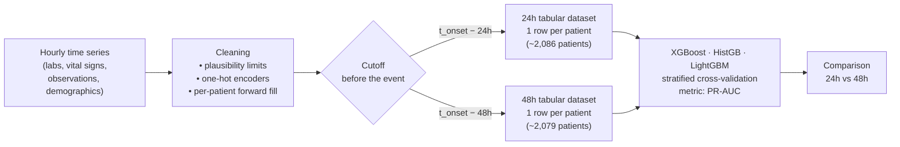
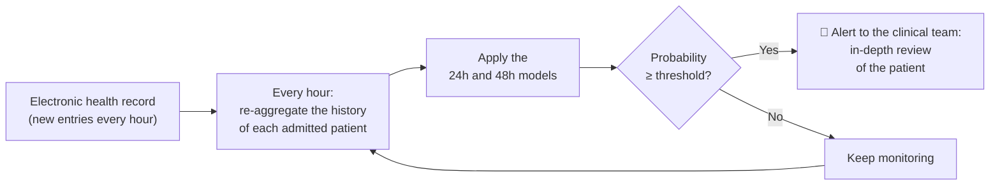

# Sepsis Prevention in Pediatric ICUs with Machine Learning

[🇧🇷 Português](README.md) | **🇺🇸 English**

Final project (TCC) — **MBA in Data Science (CEMEAI / ICMC – University of São Paulo, São Carlos), 2025**
Author: **Juscelino Alves de Carvalho** · Advisor: **Prof. Francisco Louzada**

> Early prediction of sepsis **24h** and **48h** in advance in Pediatric Intensive Care Unit patients, by
> turning hourly clinical time series into per-patient tabular datasets and modeling them with gradient
> boosting algorithms.

---

## 📚 Where to start

| I want to... | Open | Language |
|---|---|---|
| **Get the idea in a few minutes** (problem, approach, results) | [`apresentacao/Apresentacao_TCC_Sepse_PT-BR.pptx`](apresentacao/Apresentacao_TCC_Sepse_PT-BR.pptx) | PT-BR |
| **Read the full work in English** | [`docs/TCC_Sepsis_Pediatric_ICU_EN.pdf`](docs/TCC_Sepsis_Pediatric_ICU_EN.pdf) | EN (translation) |
| Read the original monograph | [`docs/TCC_Sepse_UTI_Pediatrica_PT-BR.pdf`](docs/TCC_Sepse_UTI_Pediatrica_PT-BR.pdf) | PT-BR (original) |
| **See the main pipeline code** (24h/48h aggregation + models) | [`notebooks/01_pipeline_agregacao_24h_48h_PT-BR.ipynb`](notebooks/01_pipeline_agregacao_24h_48h_PT-BR.ipynb) | PT-BR |
| See the complementary hourly-level model (hackathon submission) | [`notebooks/02_modelo_horario_hackathon_PT-BR.ipynb`](notebooks/02_modelo_horario_hackathon_PT-BR.ipynb) ([PDF](notebooks/02_modelo_horario_hackathon_PT-BR.pdf)) | PT-BR |

The file suffix tells the language: `_PT-BR` means Portuguese and `_EN` means English.

---

## 🩺 The problem

Sepsis is one of the leading causes of child morbidity and mortality worldwide. In children it can progress
quickly, and **every hour of delay** in starting treatment (antibiotics, stabilization) increases the risk of
death. Identifying at-risk patients early opens the "golden window" for the clinical team to act.

## 🗂️ The data

- **Source:** a retrospective registry from the Pediatric ICU of *Hospital Sant Joan de Déu* (Barcelona),
  released in the international challenge
  [PHEMS Hackathon – Early Sepsis Prediction (Kaggle)](https://www.kaggle.com/competitions/phems-hackathon-early-sepsis-prediction).
- **Original format:** **multivariate time series recorded every hour** (long format). Each row is one
  patient at a given day and hour, and the data are split across separate tables:
  - sepsis label (`SepsisLabel`);
  - laboratory tests (CRP, procalcitonin, lactate, potassium, hematocrit, etc.);
  - measured vital signs (blood pressure, heart and respiratory rates, temperature, SpO₂);
  - clinical observations (Glasgow, pupils, capillary refill time, pulse);
  - demographics (age in months, sex).
- **Challenges:** about **3% positive cases** (strong imbalance), **many missing values** (above 90% for
  several variables) and physiologically impossible values, such as a temperature of 39,425 °C.

> ⚠️ **The data are not included in this repository**, because Kaggle competition rules do not allow
> redistribution. To reproduce the work, download the competition data into `Data/training_data/` and
> `Data/testing_data/`, as the notebooks expect.

## 🔄 Core idea: from time series to tabular data

Instead of modeling the hourly time series directly, which would require more complex sequential models,
**each patient was summarized into a single row**, aggregating their whole history **up to a cutoff before
the event**. **Two separate datasets** were built from the same source, differing only in the window:



- **Early label:** for each patient, `t_onset` is the first hour with sepsis. In the *h*-hour dataset, a
  patient is positive if they develop sepsis, and the features use **only data up to `t_onset − h`**. This
  prevents information from the future leaking into training (*data leakage*).
- **Per-patient aggregations:** last value, mean, min, max and "was measured" indicators, among others. A
  missing exam also carries clinical information (*informative missingness*), because exams are usually only
  ordered when something is suspected.
- **Adapted forward fill:** each gap is filled with the patient's **own last valid value**, and never with
  values from other patients.
- Variables with 70% or more missing values after treatment were dropped.

## 🤖 Models and evaluation

- **Models:** `XGBClassifier`, `HistGradientBoostingClassifier` and `LGBMClassifier`. They were chosen
  because they handle missing values natively and support class weights (`scale_pos_weight` / `class_weight`).
- **Tuning:** `RandomizedSearchCV` with **stratified 5-fold cross-validation**.
- **Main metric:** **PR-AUC (Average Precision)**. With only about 3% positives, accuracy is misleading: a
  model that always answers "no" would reach about 97% accuracy and have zero clinical value. The PR-AUC
  baseline is the prevalence, about 0.03.
- **Explainability:** SHAP, used to check the clinical coherence of the most influential variables.

## 📈 Results

| Window | Best model | PR-AUC (CV, median) | PR-AUC (test) |
|---|---|---|---|
| 24h before | LightGBM | 0.338 | 0.492 |
| **48h before** | **LightGBM** | **0.574** | **0.751** |

*Baseline (prevalence) ≈ 0.03.*

**The 48h window performed clearly better and was more stable.** One hypothesis is that this horizon
captures a more general risk of clinical deterioration that precedes sepsis.

**Operating point (48h dataset, test set, 788 patients).** The threshold was chosen to maximize recall with
at least 25% precision.

| | Predicted: no sepsis | Predicted: sepsis |
|---|---|---|
| **Actual: no sepsis** | 701 (TN) | 62 (FP) |
| **Actual: sepsis** | 4 (FN) | **21 (TP)** |

The model detected **21 of 25 sepsis cases (84% recall)** with 92% specificity and a ROC-AUC of 0.96. On
average there are about 3 false alerts per true case, a cost considered acceptable in early screening, where
**a false negative costs far more than an extra alert**.

**Explainability (SHAP).** The most influential variables are clinically coherent: observation time, Glasgow
scale (low scores increase risk), inflammatory markers (CRP, neutrophils), temperature, lactate and
procalcitonin.

## 🏥 How it would be used in practice

The model is designed as an **alerting system for decision support**, **not as a diagnostic tool**:



1. The system **re-aggregates each patient's data every hour**, keeping the tabular dataset up to date with
   the history since admission.
2. The **48h** model (earlier warning) and the **24h** model (more imminent risk) are applied to every new
   aggregation.
3. When the probability crosses the threshold, the **clinical team is alerted to review the patient in
   depth**. The decision stays with the clinicians: the goal is to gain time to act **before** sepsis sets in.

## 📁 Repository structure

```
├── README.md                     ← Portuguese README
├── README.en.md                  ← this file (English)
├── requirements.txt              ← Python libraries used
├── docs/
│   ├── TCC_Sepse_UTI_Pediatrica_PT-BR.pdf   ← full monograph (original, Portuguese)
│   └── TCC_Sepsis_Pediatric_ICU_EN.pdf      ← English translation
├── apresentacao/                 ← "presentation"
│   └── Apresentacao_TCC_Sepse_PT-BR.pptx    ← defense slides (Portuguese)
└── notebooks/
    ├── 01_pipeline_agregacao_24h_48h_PT-BR.ipynb   ← main pipeline (24h/48h aggregation)
    ├── 02_modelo_horario_hackathon_PT-BR.ipynb     ← hourly variant (Kaggle submission)
    └── 02_modelo_horario_hackathon_PT-BR.pdf       ← export of notebook 02
```

## ⚙️ Reproducing

```bash
python -m venv .venv
source .venv/bin/activate       # Windows: .venv\Scripts\activate
pip install -r requirements.txt
# download the Kaggle data into ./Data/ and open the notebooks
jupyter lab
```

Original environment: Python 3.12.

## ⚠️ Disclaimer

This is **academic** work. The model **is not a medical device** and must not be used for clinical decisions
without prospective validation and regulatory approval.

## 📖 How to cite

> CARVALHO, Juscelino Alves de. **Prevention of sepsis occurrence in Pediatric Intensive Care Units**
> (*Prevenção de ocorrência de sepse em Unidades de Tratamento Intensivo Pediátricas*). 2025. Final project
> (MBA in Data Science) – Institute of Mathematical and Computer Sciences, University of São Paulo,
> São Carlos, 2025.
