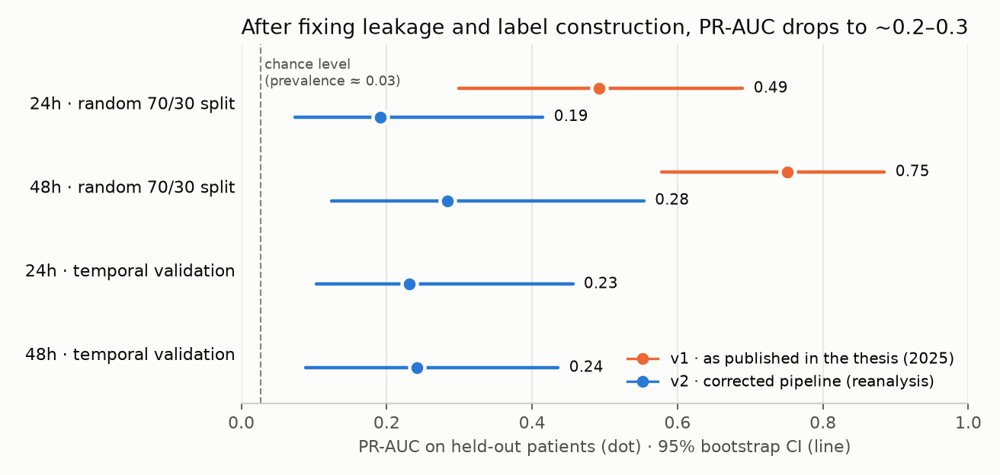
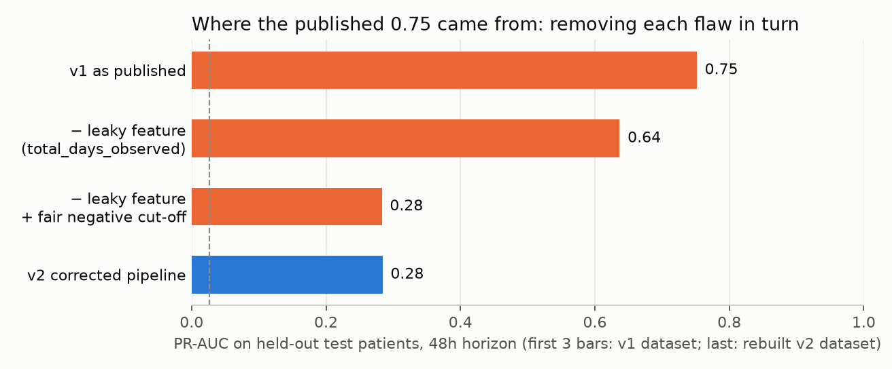
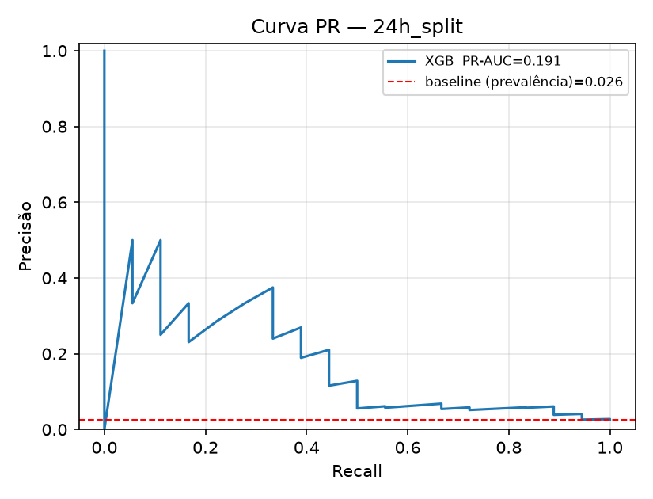
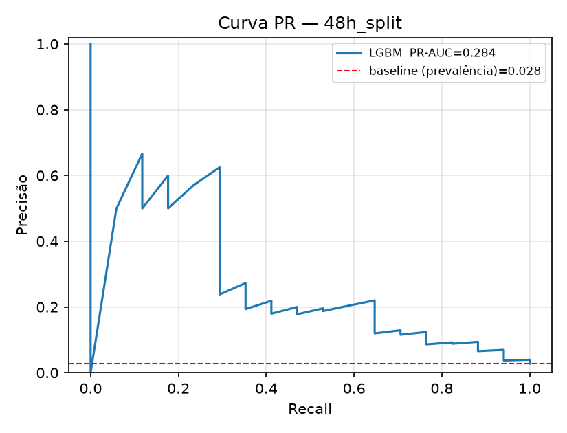
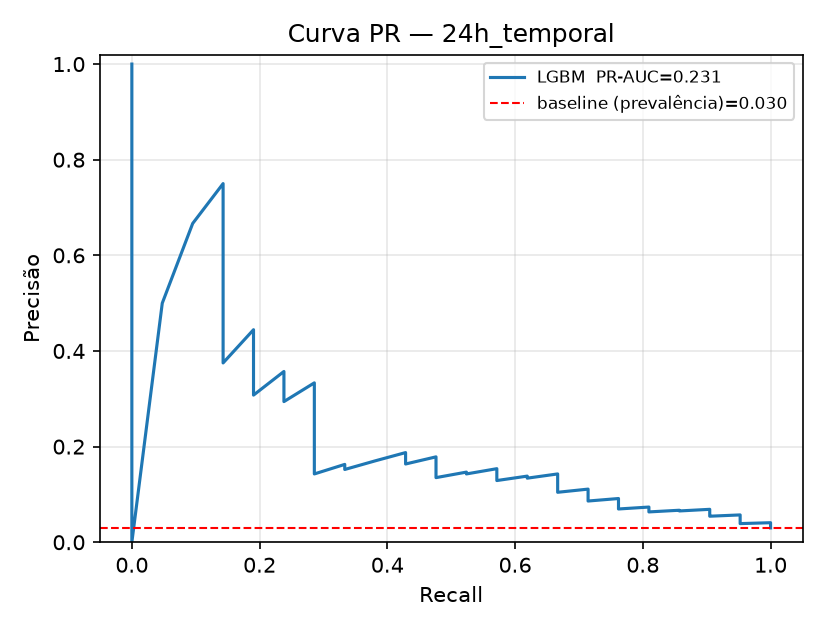
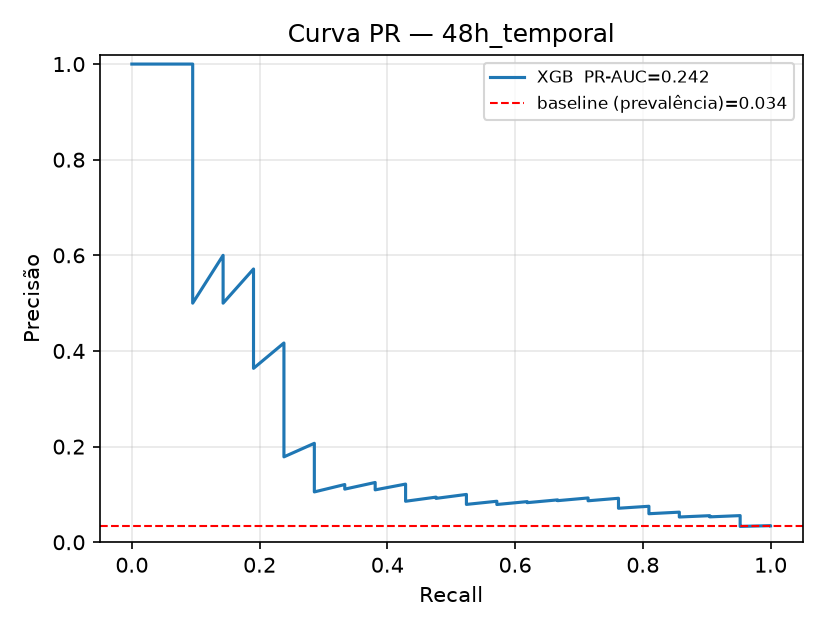
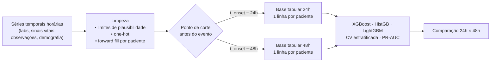
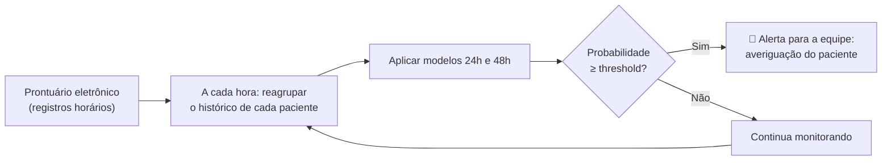

# Predição Antecipada de Sepse em UTI Pediátrica: TCC + Reanálise Crítica

**🇧🇷 Português** | [🇺🇸 English](README.en.md)

Trabalho de Conclusão de Curso, **MBA em Ciência de Dados (CEMEAI / ICMC – USP São Carlos), 2025**
Autor: **Juscelino Alves de Carvalho** · Orientador: **Prof. Francisco Louzada**


> [!IMPORTANT]
> **Leia primeiro.** Este repositório tem **duas camadas**:
>
> 1. **O TCC original (v1, 2025).** Fiz este trabalho enquanto ainda aprendia Ciência de Dados. Ele está
>    publicado **como foi entregue**, para mostrar de onde parti. A única alteração foi a correção dos
>    números do ponto de operação na p. 32 (falha nº 4 abaixo).
> 2. **A reanálise crítica (v2).** Depois de ganhar experiência, voltei ao projeto e **encontrei falhas
>    metodológicas que inflavam os resultados**: vazamento de informação do futuro (*data leakage*) e um
>    desenho de rótulos desigual entre as classes. Quantifiquei o efeito de cada falha, reconstruí o pipeline
>    e reavaliei tudo com validação mais rigorosa.
>
> **Resultado honesto:** a PR-AUC publicada de **0,75** cai para **cerca de 0,2 a 0,3** quando as falhas
> são corrigidas. O sinal preditivo existe (7 a 10 vezes acima do acaso), mas **não é suficiente para uso
> clínico**. Não escondi nada: os erros, as divergências e as correções estão documentados abaixo.
>
> 🤖 **Transparência sobre o uso de IA:** a reanálise (v2) foi feita com apoio de IA (Claude), sob minha
> direção. Todos os resultados foram reexecutados e verificados.

---

## ⚡ Resumo em 30 segundos

| | **v1: como publicado no TCC** | **v2: pipeline corrigido** |
|---|---|---|
| PR-AUC 48h (teste) | 0,75 | **0,28** (IC 95%: 0,12–0,55) |
| PR-AUC 24h (teste) | 0,49 | **0,19** (IC 95%: 0,07–0,42) |
| Validação temporal (treino em anos antigos, teste nos recentes) | não feita | **0,23 a 0,24** |
| "48h é melhor que 24h" | sim | **não se sustenta** (ICs sobrepostos) |
| Recall no ponto de operação | 84% (com vazamento) | **cerca de 30%**, com cerca de 3 alertas por caso verdadeiro |
| Pronto para uso clínico? | sugerido | **não** |

*Referência de acaso: PR-AUC igual à prevalência, de cerca de 0,03.*



---

## 🧠 O que este projeto demonstra

| Competência | Onde aparece |
|---|---|
| **Tratamento de séries temporais clínicas** (horárias, esparsas, com mais de 90% de ausência) | Agregação por paciente até um ponto de corte, limites de plausibilidade, *forward fill* por paciente, *features* de tendência e de "horas desde a última medição" |
| **Bases fortemente desbalanceadas** (cerca de 3% de positivos) | PR-AUC no lugar de acurácia, pesos de classe (`scale_pos_weight` / `class_weight`), *baseline* igual à prevalência |
| **Escolha de threshold** | Regra clínica (maior recall com precisão de pelo menos 25%), escolhida em predições *out-of-fold* do treino e **nunca no teste** |
| **Avaliação e comparação rigorosas** | IC 95% por *bootstrap*, CV estratificada repetida 5×5, **validação temporal**, comparação 24h × 48h com incerteza |
| **Detecção de *data leakage*** | Identificação de uma *feature* que olhava o futuro e de um viés na construção das classes, com experimentos de ablação para medir cada efeito |
| **Pensamento crítico e comunicação honesta** | Revisar o próprio trabalho, publicar os números que pioraram e explicar por quê |

---

## 🔍 Retrospectiva: o que estava errado na v1



| # | Falha na v1 | Por que inflava o resultado | Efeito medido (PR-AUC 48h) | Correção na v2 |
|---|---|---|---|---|
| 1 | **`total_days_observed` com vazamento.** Calculada com a **última data de todo o histórico** do paciente, inclusive depois da sepse | O modelo "sabia" quanto tempo o paciente ainda ficaria internado, uma informação indisponível no momento da predição. Era a **feature nº 1** do modelo de 48h | 0,75 → 0,64 | Removida. No lugar, `hours_since_admission`, calculada **só até o corte** |
| 2 | **Corte desigual entre as classes.** Negativos resumidos **até o fim da internação**, positivos **antes da sepse** | O modelo aprendia "início de internação × fim de internação", e não "vai ter sepse × não vai" | 0,64 → 0,28 | Corte dos negativos sorteado com a **mesma distribuição de horas desde a admissão** dos positivos |
| 3 | **Linhas sintéticas D-1/D-2.** 17 (24h) e 26 (48h) dos 82 positivos **não tinham nenhum dado clínico** antes do corte | Positivos "vazios" com um padrão de ausência próprio, fácil de reconhecer | não medido isoladamente | Sem linhas sintéticas. **Mesma regra de inclusão** para as duas classes: pelo menos 6h de internação e alguma medição real |
| 4 | **Bug no notebook (célula 70).** Recall e precisão impressos com um índice herdado da curva de 24h | A versão entregue da monografia (p. 32) informava *Recall 0,72 / Precisão 0,69*, valores inconsistentes com a matriz de confusão | — | Corrigido no notebook 01 (linhas antigas mantidas comentadas) e no PDF da monografia publicado aqui. Valores certos: recall 0,84 e precisão 0,25 |
| 5 | **Avaliação frágil.** Um único split, com 25 positivos no teste e sem intervalo de confiança | Com tão poucos positivos, um número isolado parece mais preciso do que é (IC real: 0,58 a 0,88) | — | *Bootstrap*, CV repetida 5×5 e validação temporal |

> **Como encontrei as falhas:** a *feature* mais importante ser "tempo total de observação" foi o primeiro
> alerta. Uma variável administrativa vencendo os marcadores clínicos costuma indicar vazamento. Daí vieram os
> experimentos de ablação em [`reanalysis/01_diagnose_v1.py`](reanalysis/01_diagnose_v1.py), que mudam **um
> fator por vez** sobre o pipeline original.

---

## ✅ Versão corrigida (v2)

**Código:** [`reanalysis/02_corrected_pipeline_v2.py`](reanalysis/02_corrected_pipeline_v2.py) ·
**Resultados brutos:** [`reanalysis/results/results_v2.json`](reanalysis/results/results_v2.json)

| | 24h | 48h |
|---|---|---|
| Pacientes / com sepse | 2.332 / 61 | 2.039 / 56 |
| Sepses excluídas (cedo demais, sem dados antes do corte) | 36 de 97 | 41 de 97 |
| **Split 70/30:** PR-AUC (IC 95%) · ROC-AUC | 0,19 (0,07–0,42) · 0,79 | 0,28 (0,12–0,55) · 0,87 |
| **CV repetida 5×5:** PR-AUC média ± dp | 0,24 ± 0,08 | 0,18 ± 0,10 |
| **Validação temporal:** PR-AUC (IC 95%) · ROC-AUC | 0,23 (0,10–0,46) · 0,84 | 0,24 (0,09–0,44) · 0,77 |
| **Ponto de operação** (threshold OOF): recall / precisão / especificidade | 0,33 / 0,35 / 0,98 | 0,29 / 0,36 / 0,98 |
| Matriz de confusão (VN / FP / FN / VP) | 671 / 11 / 12 / 6 | 586 / 9 / 12 / 5 |

**Variáveis mais importantes:** temperatura, PCR, procalcitonina, lactato, hematócrito e horas desde a
admissão. Também pesam as **contagens de exames pedidos** (neutrófilos, hematócrito, gasometria).

<details>
<summary>Curvas Precisão × Recall da v2 (clique para abrir)</summary>

| 24h, split | 48h, split |
|---|---|
|  |  |
| **24h, temporal** | **48h, temporal** |
|  |  |

</details>

---

## 🏥 Por que não serve na prática, mas vale como estudo

**Por que não é utilizável clinicamente:**
- O modelo detecta **cerca de 1 em cada 3 sepses**, com cerca de 3 alertas por caso verdadeiro. Para ganhar
  recall, a precisão cai rapidamente.
- Parte do sinal é a **própria suspeita da equipe**: a quantidade de exames pedidos pesa no modelo. Ele capta
  em parte o que os médicos já perceberam, o que limita o ganho real.
- **Cerca de 40% das sepses ocorrem cedo demais** (poucas horas após a admissão) para qualquer predição com
  24 ou 48h de antecedência.
- São poucos positivos (17 a 21 por teste, por isso os ICs largos), um único hospital e um único ponto de
  corte por paciente. O uso real exigiria pontuar a cada hora.

**Por que continua sendo um bom estudo:**
- O sinal é **real e estável**, entre 7 e 10 vezes acima do acaso, e **não piora** na validação temporal.
- A abordagem (série horária → base tabular por janela de antecedência → *gradient boosting* com métricas
  adequadas ao desbalanceamento) é válida e está documentada de ponta a ponta.
- A comparação v1 × v2 é um **caso concreto de como o *data leakage* infla métricas** e de como detectá-lo e
  medi-lo.

**Próximos passos, se fosse para produção:** pontuação horária para todos os pacientes internados, dados de
mais hospitais e anos, e comparação com escores clínicos simples (qSOFA, critérios pediátricos de Phoenix)
para medir o ganho real do modelo.

---

## 📚 Por onde começar

| Quero... | Abra |
|---|---|
| **Ver a reanálise e o código corrigido** | [`reanalysis/`](reanalysis/) |
| Entender a ideia original em poucos minutos | [`apresentacao/Apresentacao_TCC_Sepse_PT-BR.pptx`](apresentacao/Apresentacao_TCC_Sepse_PT-BR.pptx) |
| Ler o TCC completo (original, v1) | [`docs/TCC_Sepse_UTI_Pediatrica_PT-BR.pdf`](docs/TCC_Sepse_UTI_Pediatrica_PT-BR.pdf) |
| Ler o TCC em inglês (tradução, com nota de correção na seção 4.2) | [`docs/TCC_Sepsis_Pediatric_ICU_EN.pdf`](docs/TCC_Sepsis_Pediatric_ICU_EN.pdf) |
| Ver o notebook original do TCC (v1) | [`notebooks/01_pipeline_agregacao_24h_48h_PT-BR.ipynb`](notebooks/01_pipeline_agregacao_24h_48h_PT-BR.ipynb) |
| Ver a variante horária (submissão do hackathon) | [`notebooks/02_modelo_horario_hackathon_PT-BR.ipynb`](notebooks/02_modelo_horario_hackathon_PT-BR.ipynb) |

---

## 📜 O TCC original (v1), como foi entregue

<details>
<summary><b>Problema, dados, abordagem e resultados originais</b> (clique para abrir)</summary>

### O problema
A sepse é uma das principais causas de morbidade e mortalidade infantil. Em crianças, o quadro pode evoluir
rapidamente, e **cada hora de atraso** no tratamento aumenta o risco de morte. Prever o risco com antecedência
cria uma "janela de ouro" para a equipe agir.

### Os dados
- **Origem:** UTI Pediátrica do *Hospital Sant Joan de Déu* (Barcelona), via
  [PHEMS Hackathon – Early Sepsis Prediction (Kaggle)](https://www.kaggle.com/competitions/phems-hackathon-early-sepsis-prediction).
- **Formato:** séries temporais multivariadas **horárias**, com rótulo de sepse, exames laboratoriais, sinais
  vitais, observações clínicas (Glasgow, pupilas, enchimento capilar) e demografia.
- **Desafios:** cerca de 3% de positivos, muitos valores ausentes e valores fisiologicamente impossíveis.

> ⚠️ **Os dados não estão no repositório**, porque as regras do Kaggle não permitem redistribuí-los. Baixe-os
> da competição e coloque-os em `Data/training_data/` e `Data/testing_data/`.

### A ideia central: de série temporal para base tabular



Modelos `XGBClassifier`, `HistGradientBoostingClassifier` e `LGBMClassifier`, otimizados com
`RandomizedSearchCV` (CV estratificada de 5 folds), métrica PR-AUC e explicabilidade com SHAP.

### Resultados como publicados (v1) — ⚠️ inflados, ver a retrospectiva acima

| Janela | Melhor modelo | PR-AUC (CV, mediana) | PR-AUC (teste) |
|---|---|---|---|
| 24h | LightGBM | 0,338 | 0,492 |
| 48h | LightGBM | 0,574 | 0,751 |

Ponto de operação 48h no teste: VN 701 / FP 62 / FN 4 / VP 21, ou seja, recall 0,84, precisão 0,25 e
ROC-AUC 0,96. A versão entregue da monografia trazia na p. 32 *Recall 0,72 / Precisão 0,69*, por causa do bug
da célula 70 (falha nº 4 acima). O PDF publicado aqui já traz os valores corrigidos.

### Uso proposto na prática



A ideia de **alerta para apoio à decisão** (e não de diagnóstico) continua válida. O que a reanálise mostra
é que o modelo atual não tem desempenho suficiente para sustentá-la.

</details>

---

## 📁 Estrutura

```
├── README.md / README.en.md        ← este documento (PT-BR / EN)
├── requirements.txt
├── reanalysis/                     ← ⭐ reanálise crítica e versão corrigida (v2)
│   ├── 01_diagnose_v1.py           ← ablação: mede o efeito de cada falha da v1
│   ├── 02_corrected_pipeline_v2.py ← pipeline corrigido
│   ├── 03_make_figures.py          ← gera as figuras do README a partir dos JSONs
│   ├── results/                    ← métricas brutas (JSON)
│   └── figures/
├── docs/                           ← monografia original (PT) e tradução (EN)
├── apresentacao/                   ← slides da defesa
└── notebooks/                      ← notebooks originais do TCC (v1)
```

## ⚙️ Reproduzindo

```bash
python -m venv .venv
.venv\Scripts\activate                      # Linux/Mac: source .venv/bin/activate
pip install -r requirements.txt
# coloque os dados do Kaggle em ./Data/training_data/
python reanalysis/01_diagnose_v1.py . reanalysis/results/results_v1_diagnosis.json
python reanalysis/02_corrected_pipeline_v2.py
python reanalysis/03_make_figures.py
```

## ⚠️ Aviso

Trabalho **acadêmico**. O modelo **não é um dispositivo médico** e não deve ser usado em decisões clínicas.

## 📖 Como citar

> CARVALHO, Juscelino Alves de. **Prevenção de ocorrência de sepse em Unidades de Tratamento Intensivo
> Pediátricas.** 2025. Trabalho de Conclusão de Curso (MBA em Ciência de Dados) – Instituto de Ciências
> Matemáticas e de Computação, Universidade de São Paulo, São Carlos, 2025.
