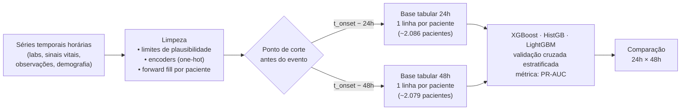
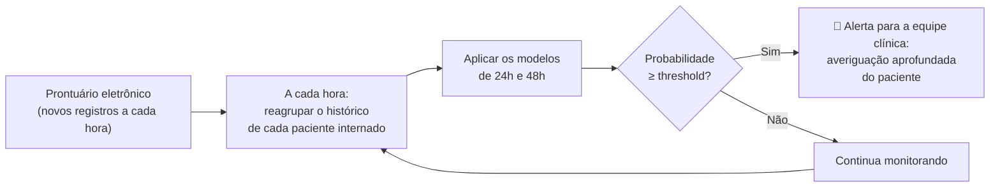

# Prevenção de Sepse em UTIs Pediátricas com Machine Learning

**🇧🇷 Português** | [🇺🇸 English](README.en.md)

Trabalho de Conclusão de Curso — **MBA em Ciência de Dados (CEMEAI / ICMC – USP São Carlos), 2025**
Autor: **Juscelino Alves de Carvalho** · Orientador: **Prof. Francisco Louzada**

> Predição antecipada de sepse, com **24h** e **48h** de antecedência, em pacientes de Unidades de Terapia
> Intensiva Pediátricas. As séries temporais clínicas horárias foram transformadas em bases tabulares por
> paciente e modeladas com algoritmos de *gradient boosting*.

---

## 📚 Por onde começar

| Quero... | Abra | Idioma |
|---|---|---|
| **Entender a ideia em poucos minutos** (problema, abordagem, resultados) | [`apresentacao/Apresentacao_TCC_Sepse_PT-BR.pptx`](apresentacao/Apresentacao_TCC_Sepse_PT-BR.pptx) | PT-BR |
| **Ler o trabalho completo** (revisão, metodologia, métricas, discussão) | [`docs/TCC_Sepse_UTI_Pediatrica_PT-BR.pdf`](docs/TCC_Sepse_UTI_Pediatrica_PT-BR.pdf) | PT-BR (original) |
| **Read the full work in English** | [`docs/TCC_Sepsis_Pediatric_ICU_EN.pdf`](docs/TCC_Sepsis_Pediatric_ICU_EN.pdf) | EN (tradução) |
| **Ver o código do pipeline principal** (agregação 24h/48h + modelos) | [`notebooks/01_pipeline_agregacao_24h_48h_PT-BR.ipynb`](notebooks/01_pipeline_agregacao_24h_48h_PT-BR.ipynb) | PT-BR |
| Ver a modelagem complementar em nível horário (submissão do hackathon) | [`notebooks/02_modelo_horario_hackathon_PT-BR.ipynb`](notebooks/02_modelo_horario_hackathon_PT-BR.ipynb) ([PDF](notebooks/02_modelo_horario_hackathon_PT-BR.pdf)) | PT-BR |

O sufixo do arquivo indica o idioma: `_PT-BR` para português e `_EN` para inglês.

---

## 🩺 O problema

A sepse é uma das principais causas de morbidade e mortalidade infantil no mundo. Em crianças, o quadro pode
evoluir rapidamente, e **cada hora de atraso** no início do tratamento, como antibióticos e estabilização,
aumenta o risco de morte. Identificar com antecedência os pacientes em risco cria a "janela de ouro" para a
equipe clínica agir.

## 🗂️ Os dados

- **Origem:** registro retrospectivo da UTI Pediátrica do *Hospital Sant Joan de Déu* (Barcelona),
  disponibilizado no desafio internacional
  [PHEMS Hackathon – Early Sepsis Prediction (Kaggle)](https://www.kaggle.com/competitions/phems-hackathon-early-sepsis-prediction).
- **Formato original:** **séries temporais multivariadas, registradas hora a hora** (formato longo). Cada
  linha é um paciente em um determinado dia e hora, e os dados vêm distribuídos em tabelas separadas:
  - rótulo de sepse (`SepsisLabel`);
  - exames laboratoriais (PCR, procalcitonina, lactato, potássio, hematócrito etc.);
  - sinais vitais medidos (pressão arterial, frequências cardíaca e respiratória, temperatura, SpO₂);
  - observações clínicas (Glasgow, pupilas, tempo de enchimento capilar, pulso);
  - dados demográficos (idade em meses, sexo).
- **Desafios:** cerca de **3% de casos positivos** (forte desbalanceamento), **muitos valores ausentes**
  (acima de 90% em várias variáveis) e valores fisiologicamente impossíveis, como temperatura de 39.425 °C.

> ⚠️ **Os dados não estão incluídos neste repositório**, porque as regras do Kaggle não permitem
> redistribuí-los. Para reproduzir o trabalho, baixe os dados da competição e coloque-os em
> `Data/training_data/` e `Data/testing_data/`, como esperado pelos notebooks.

## 🔄 A ideia central: de série temporal para base tabular

Em vez de modelar diretamente a série temporal horária, o que exigiria modelos sequenciais mais complexos,
**cada paciente foi resumido em uma única linha**, agregando todo o seu histórico **até um ponto de corte
anterior ao evento**. Foram construídas **duas bases separadas**, com a mesma origem e diferindo apenas na
janela:



- **Rótulo antecipado:** para cada paciente, `t_onset` é a primeira hora com sepse. Na base de *h* horas, o
  paciente é positivo se desenvolve sepse, e as features usam **somente dados até `t_onset − h`**. Isso evita
  vazamento de informação do futuro (*data leakage*).
- **Agregações por paciente:** último valor, média, mínimo, máximo e indicadores de "foi medido", entre
  outras. A ausência de um exame também carrega informação clínica (*informative missingness*), porque um
  exame normalmente só é pedido quando há suspeita.
- **Forward fill adaptado:** cada lacuna é preenchida com o **último valor válido** do próprio paciente, e
  nunca com valores de outros pacientes.
- Variáveis com 70% ou mais de ausência após o tratamento foram descartadas.

## 🤖 Modelos e avaliação

- **Modelos:** `XGBClassifier`, `HistGradientBoostingClassifier` e `LGBMClassifier`. Foram escolhidos por
  lidarem nativamente com valores ausentes e permitirem pesos de classe (`scale_pos_weight` / `class_weight`).
- **Otimização:** `RandomizedSearchCV` com **validação cruzada estratificada de 5 folds**.
- **Métrica principal:** **PR-AUC (Average Precision)**. Com apenas cerca de 3% de positivos, a acurácia é
  enganosa: um modelo que sempre responde "não" teria cerca de 97% de acurácia e nenhuma utilidade clínica.
  O *baseline* da PR-AUC é a prevalência, de cerca de 0,03.
- **Explicabilidade:** SHAP, para conferir a coerência clínica das variáveis mais influentes.

## 📈 Resultados

| Janela | Melhor modelo | PR-AUC (CV, mediana) | PR-AUC (teste) |
|---|---|---|---|
| 24h antes | LightGBM | 0,338 | 0,492 |
| **48h antes** | **LightGBM** | **0,574** | **0,751** |

*Baseline (prevalência) ≈ 0,03.*

**A janela de 48h teve resultado claramente superior e mais estável.** Uma hipótese é que esse horizonte
capta um risco mais geral de deterioração clínica, que antecede a sepse.

**Ponto de operação (base 48h, conjunto de teste, 788 pacientes).** O *threshold* foi escolhido para
maximizar o *recall* com precisão mínima de 25%.

| | Previsto: sem sepse | Previsto: sepse |
|---|---|---|
| **Real: sem sepse** | 701 (VN) | 62 (FP) |
| **Real: sepse** | 4 (FN) | **21 (VP)** |

> 📝 **Errata:** a monografia em português (p. 32) informa *Recall 0,72 / Precisão 0,69* neste ponto. Esses
> valores vinham de uma célula do notebook que lia as métricas de um índice herdado da curva de 24h. Os valores
> corretos, consistentes com a matriz de confusão, estão acima. O notebook 01 e o PDF em inglês já foram
> corrigidos, e as linhas antigas foram mantidas comentadas no notebook.

O modelo detectou **21 de 25 casos de sepse (recall de 84%)** com especificidade de 92% e ROC-AUC de 0,96.
Em média, há cerca de 3 alertas falsos para cada caso verdadeiro, um custo considerado aceitável em triagem
precoce, onde **um falso negativo custa muito mais do que um alerta extra**.

**Explicabilidade (SHAP).** As variáveis mais influentes são coerentes com a clínica: tempo de observação,
escala de Glasgow (escores baixos aumentam o risco), marcadores inflamatórios (PCR, neutrófilos), temperatura,
lactato e procalcitonina.

## 🏥 Como seria o uso na prática

O modelo foi pensado como um **sistema de alerta para apoio à decisão**, e **não como ferramenta de
diagnóstico**:



1. O sistema **reagrupa os dados de cada paciente de hora em hora**, mantendo a base tabular atualizada com o
   histórico desde a internação.
2. Os modelos de **48h** (alerta mais precoce) e **24h** (risco mais iminente) são aplicados a cada novo
   agrupamento.
3. Quando a probabilidade passa do *threshold*, a **equipe clínica é alertada para uma averiguação
   aprofundada** do paciente. A decisão continua sendo clínica: o objetivo é ganhar tempo para agir **antes**
   de o quadro séptico se instalar.

## 📁 Estrutura do repositório

```
├── README.md                     ← este arquivo (PT-BR)
├── README.en.md                  ← versão em inglês
├── requirements.txt              ← bibliotecas Python usadas
├── docs/
│   ├── TCC_Sepse_UTI_Pediatrica_PT-BR.pdf   ← monografia completa (original)
│   └── TCC_Sepsis_Pediatric_ICU_EN.pdf      ← tradução para o inglês
├── apresentacao/
│   └── Apresentacao_TCC_Sepse_PT-BR.pptx    ← slides da defesa
└── notebooks/
    ├── 01_pipeline_agregacao_24h_48h_PT-BR.ipynb   ← pipeline principal do TCC
    ├── 02_modelo_horario_hackathon_PT-BR.ipynb     ← variante horária (submissão Kaggle)
    └── 02_modelo_horario_hackathon_PT-BR.pdf       ← exportação do notebook 02
```

## ⚙️ Reproduzindo

```bash
python -m venv .venv
.venv\Scripts\activate          # Windows  (Linux/Mac: source .venv/bin/activate)
pip install -r requirements.txt
# baixe os dados do Kaggle para ./Data/ e abra os notebooks
jupyter lab
```

Ambiente original: Python 3.12.

## ⚠️ Aviso

Este é um trabalho **acadêmico**. O modelo **não é um dispositivo médico** e não deve ser usado para decisões
clínicas sem validação prospectiva e aprovação regulatória.

## 📖 Como citar

> CARVALHO, Juscelino Alves de. **Prevenção de ocorrência de sepse em Unidades de Tratamento Intensivo
> Pediátricas.** 2025. Trabalho de Conclusão de Curso (MBA em Ciência de Dados) – Instituto de Ciências
> Matemáticas e de Computação, Universidade de São Paulo, São Carlos, 2025.
